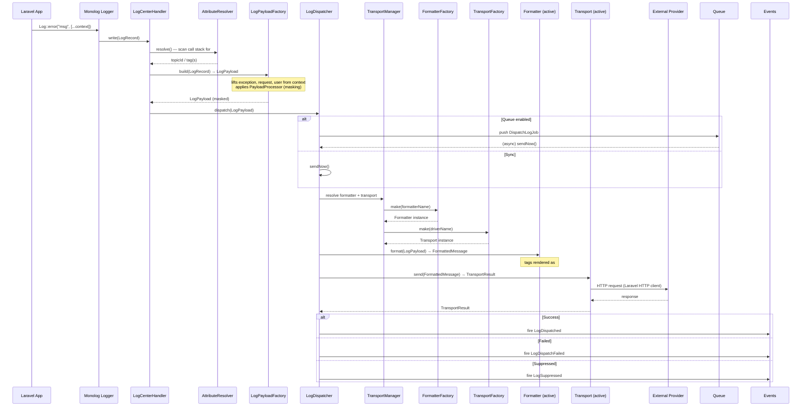
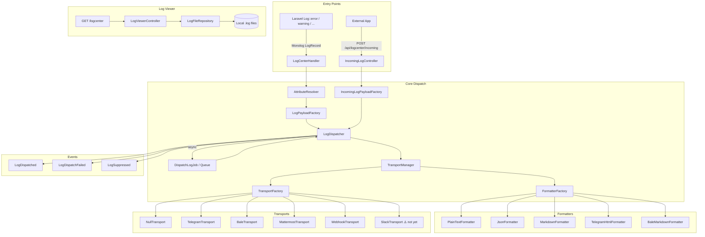
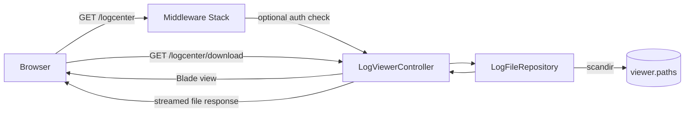
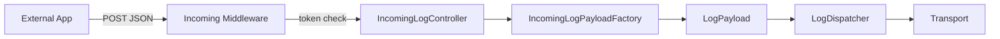

# Laravel Log Center — Architecture & Documentation

> Package: `nabafzar/laravel-log-center`  
> Namespace: `Nabafzar\LogCenter`  
> PHP `^8.2` · Laravel 10/11/12/13 · Monolog `^3.0`

---

## Table of Contents

1. [Overview](#overview)
2. [Dispatch Flow](#dispatch-flow)
3. [Component Map](#component-map)
4. [Class Diagram](#class-diagram)
5. [Transport Drivers](#transport-drivers)
6. [Formatters](#formatters)
7. [Log Viewer](#log-viewer)
8. [Incoming Log Ingress](#incoming-log-ingress)
9. [Configuration Keys](#configuration-keys)
10. [Extension Points](#extension-points)
11. [Hard Rules](#hard-rules)
12. [Implementation Status](#implementation-status)

---

## Overview

Laravel Log Center is a Laravel library package that intercepts log events via a custom
Monolog handler and routes them to configurable **transports** (Telegram, Bale, Mattermost,
Webhook, or Null). Before sending, messages pass through a **formatter** and a **secret masker**.
Optional async dispatch via Laravel queues is supported.

The package also ships:
- A **built-in log viewer** (web UI) for browsing local Laravel log files.
- An **incoming log ingress** API route for external apps to push log entries.

---

## Dispatch Flow



---

## Component Map



---

## Class Diagram

```mermaid
classDiagram
    class LogCenterServiceProvider {
        +register()
        +boot()
    }

    class LogCenterHandler {
        -LogDispatcher $dispatcher
        +write(LogRecord): void
    }

    class LogPayload {
        +string $level
        +string $message
        +array $context
        +array $extra
        +array $meta
        +array $tags
        +?ExceptionInfo $exception
        +?RequestInfo $request
        +?string $userId
        +?string $source
    }

    class FormattedMessage {
        +string $content
        +MessageFormatEnum $format
        +array $meta
    }

    class TransportResult {
        +bool $success
        +bool $retryable
        +?string $error
    }

    class LogDispatcher {
        +dispatch(LogPayload): TransportResult
        -sendNow(LogPayload): TransportResult
        -attemptSend(LogPayload): TransportResult
    }

    class TransportManager {
        +resolveFormatter(): LogFormatterInterface
        +resolveTransport(): LogTransportInterface
    }

    class TransportFactory {
        +make(string driver): LogTransportInterface
        +extend(string, callable): void
    }

    class FormatterFactory {
        +make(string name): LogFormatterInterface
    }

    class LogPayloadFactory {
        +build(LogRecord): LogPayload
    }

    class AttributeResolver {
        +resolve(): ?LogTopicResult
    }

    class LogTopic {
        <<Attribute>>
        +?int $topicId
        +?string $tag
        +array $tags
    }

    class SuppressionManager {
        +isSuppressed(LogPayload): bool
    }

    class PayloadProcessor {
        +process(LogPayload): LogPayload
    }

    class AbstractTransport {
        +send(FormattedMessage): TransportResult
        +supportsTopics(): bool
        +supportedFormats(): array
    }

    class TelegramTransport {
        +send(FormattedMessage): TransportResult
        +supportsTopics(): bool
        -resolveTopicId(LogPayload): ?int
    }

    class BaleTransport {
        +send(FormattedMessage): TransportResult
    }

    class MattermostTransport {
        +send(FormattedMessage): TransportResult
    }

    class WebhookTransport {
        +send(FormattedMessage): TransportResult
    }

    class NullTransport {
        +send(FormattedMessage): TransportResult
    }

    class AbstractFormatter {
        +format(LogPayload): FormattedMessage
        #buildSections(LogPayload): array
        #renderException(): string
        #renderUser(): string
        #renderSource(): string
    }

    class PlainTextFormatter
    class JsonFormatter
    class MarkdownFormatter
    class TelegramHtmlFormatter
    class BaleMarkdownFormatter

    class LogFileRepository {
        +listFiles(): array
        +readEntries(file, page): array
    }

    class LogViewerController {
        +index(Request): Response
        +download(Request): Response
    }

    class IncomingLogController {
        +store(Request): JsonResponse
    }

    class DispatchLogJob {
        +handle(): void
    }

    %% Interfaces
    class LogTransportInterface {
        <<interface>>
        +send(FormattedMessage): TransportResult
        +supportsTopics(): bool
        +supportedFormats(): array
    }

    class LogFormatterInterface {
        <<interface>>
        +format(LogPayload): FormattedMessage
    }

    class LogDispatcherInterface {
        <<interface>>
        +dispatch(LogPayload): TransportResult
    }

    LogCenterHandler --> LogDispatcher
    LogCenterHandler --> LogPayloadFactory
    LogCenterHandler --> AttributeResolver
    LogDispatcher ..|> LogDispatcherInterface
    LogDispatcher --> TransportManager
    LogDispatcher --> SuppressionManager
    TransportManager --> TransportFactory
    TransportManager --> FormatterFactory
    AbstractTransport ..|> LogTransportInterface
    TelegramTransport --|> AbstractTransport
    BaleTransport --|> AbstractTransport
    MattermostTransport --|> AbstractTransport
    WebhookTransport --|> AbstractTransport
    NullTransport --|> AbstractTransport
    AbstractFormatter ..|> LogFormatterInterface
    PlainTextFormatter --|> AbstractFormatter
    JsonFormatter --|> AbstractFormatter
    MarkdownFormatter --|> AbstractFormatter
    TelegramHtmlFormatter --|> AbstractFormatter
    BaleMarkdownFormatter --|> AbstractFormatter
    LogCenterServiceProvider --> LogCenterHandler
    DispatchLogJob --> LogDispatcher
    LogPayloadFactory --> LogPayload
    LogPayloadFactory --> PayloadProcessor
    LogViewerController --> LogFileRepository
    AttributeResolver --> LogTopic
```



---

## Transport Drivers

| Driver | Status | Auth | Formatter | Topics |
|---|---|---|---|---|
| `null` | ✅ Implemented | — | any | No |
| `telegram` | ✅ Implemented | Bot Token | `telegram_html` | ✅ Yes |
| `bale` | ✅ Implemented | Bot Token | `bale_markdown` | No |
| `mattermost` | ✅ Implemented | Bot Token / Webhook | `markdown` / `plain` | No |
| `webhook` | ✅ Implemented | Header / none | `json` / `plain` | No |
| `slack` | ⚠️ Config only | Webhook URL | — | No |

### Telegram Topic Routing

```mermaid
flowchart TD
    A[TelegramTransport.send()] --> B{meta.logcenter_topic_id?}
    B -- Yes --> SEND[Send to that topic]
    B -- No --> C{drivers.telegram.tag_topics match?}
    C -- Yes --> SEND
    C -- No --> D{topics_level[level]?}
    D -- Yes --> SEND
    D -- No --> E{topic_id default?}
    E -- Yes --> SEND
    E -- No --> F[Send to main thread]
```

---

## Formatters

| Formatter | Key | Output | Escaping | Used By |
|---|---|---|---|---|
| `PlainTextFormatter` | `plain` | Plain text | None | Mattermost, Webhook, generic |
| `JsonFormatter` | `json` | JSON string | — | Webhook |
| `MarkdownFormatter` | `markdown` | Markdown | `*`, `_`, `` ` `` | Mattermost |
| `TelegramHtmlFormatter` | `telegram_html` | HTML | `<`, `>`, `&` | Telegram |
| `BaleMarkdownFormatter` | `bale_markdown` | Markdown | Bale dialect | Bale |

Each formatter extends `AbstractFormatter` and outputs a `FormattedMessage` with:
- `content` — the formatted string, length-limited per config.
- `format` — `MessageFormatEnum` value (`plain`, `html`, `markdown`, `json`).
- `meta` — extra hints for the transport (parse mode, content type, etc.).

---

## Log Viewer



**Key config keys:**

| Key | Purpose |
|---|---|
| `viewer.enabled` | Toggle viewer on/off |
| `viewer.route_prefix` | URL prefix (default: `logcenter`) |
| `viewer.middleware` | Middleware stack |
| `viewer.auth.enabled` | Add auth middleware |
| `viewer.paths` | Directories/files to scan |
| `viewer.per_page` | Entries per page |
| `viewer.max_files` | Max files shown in sidebar |
| `viewer.max_file_size` | Max file size accepted |

---

## Incoming Log Ingress

External apps can push log entries directly to the package:

```
POST /api/logcenter/incoming
Authorization: X-Log-Token: <token>   (if incoming.auth.enabled)
Content-Type: application/json

{
    "level": "error",
    "message": "Something failed",
    "context": { ... }
}
```



---

## Configuration Keys

```
logcenter.php
├── default              ← active transport driver (LOGCENTER_DRIVER)
├── level                ← minimum log level (LOGCENTER_LEVEL)
├── formatter            ← global formatter (LOGCENTER_FORMATTER)
├── queue
│   ├── enabled
│   ├── connection
│   └── queue
├── mask
│   ├── replacement
│   ├── case_sensitive
│   └── keys[]
├── truncate
│   ├── message
│   └── trace
├── viewer
│   ├── enabled / route_prefix / middleware
│   ├── auth.enabled / auth.middleware
│   ├── paths[] / per_page / max_files
│   ├── max_file_size / max_entry_lines
│   └── ...
├── incoming
│   ├── enabled / route_prefix / middleware
│   └── auth.enabled / auth.header / auth.token
├── formatters
│   ├── plain / json / markdown
│   ├── telegram_html / bale_markdown
│   └── (each: max_length, trace_max_length, ...)
└── drivers
    ├── telegram  (token, chat_id, topic_id, topics_level, tag_topics, ...)
    ├── bale      (token, chat_id, base_url, ...)
    ├── mattermost (bot_token, webhook, channel_id, ...)
    ├── webhook   (url, method, payload, ...)
    └── slack     (webhook, channel — config only, transport not implemented)
```

---

## Extension Points

### Custom Transport

```php
// In a ServiceProvider
TransportFactory::extend('discord', function (array $config) {
    return new DiscordTransport($config);
});
```

Implement `LogTransportInterface`:

```php
class DiscordTransport extends AbstractTransport
{
    public function send(FormattedMessage $message): TransportResult { ... }
    public function supportsTopics(): bool { return false; }
    public function supportedFormats(): array { return [MessageFormatEnum::Plain]; }
}
```

### Custom Formatter

`FormatterFactory` does not yet have an `extend()` mechanism (planned). Until then,
swap the formatter key in config or bind a custom implementation in the container.

---

## Hard Rules

1. **Mask before format** — `PayloadProcessor` must run before any formatter or transport sees the payload.
2. **No recursive logging** — `LogCenterHandler` error paths must use `error_log()`, never `Log::*()`.
3. **No real HTTP in tests** — use Laravel's `Http::fake()`.
4. **Slack is not production-ready** — do not set `LOGCENTER_DRIVER=slack` until the transport class is implemented.
5. **strict_types=1** — all new PHP files must declare strict types.

---

## Implementation Status

| Component | Status |
|---|---|
| Core dispatch pipeline | ✅ Complete |
| Secret masking | ✅ Complete |
| Queue async dispatch | ✅ Complete |
| `#[LogTopic]` attribute routing | ✅ Complete |
| Telegram transport | ✅ Complete |
| Bale transport | ✅ Complete |
| Mattermost transport | ✅ Complete |
| Webhook transport | ✅ Complete |
| Null transport | ✅ Complete |
| Log Viewer (web UI) | ✅ Complete (needs perf hardening) |
| Incoming log ingress | ✅ Complete |
| Events (dispatched/failed/suppressed) | ✅ Complete |
| Slack transport | ⚠️ Config only — class missing |
| `FormatterFactory::extend()` | ⚠️ Not yet implemented |
| Viewer large-file pagination | ⚠️ Needs hardening |
| End-to-end Laravel channel integration tests | ⚠️ Planned |
